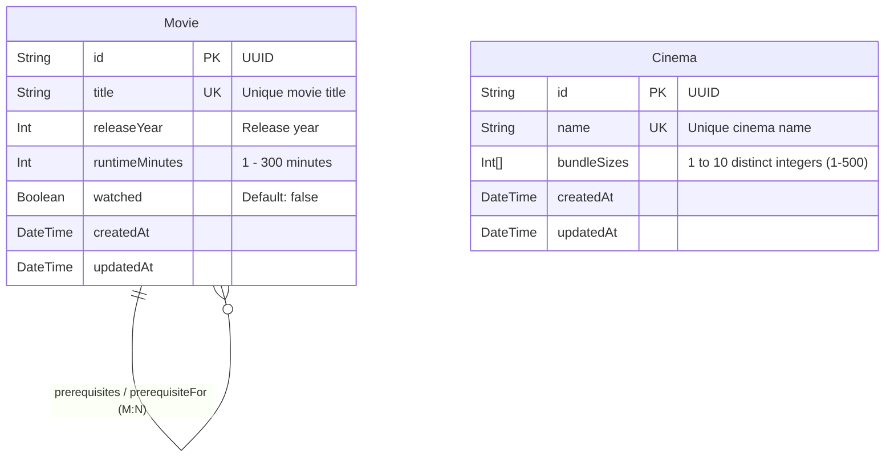

# Doomsday Ready

Full-stack MCU rewatch planner and cinema watch-party booking application built for MCU fans gearing up for *Avengers: Doomsday*.

---

## Tech Stack
- **Backend**: Node.js, Express, TypeScript, Prisma ORM, PostgreSQL, Zod, Vitest
- **Frontend**: React, TypeScript, Vite, Tailwind CSS, Lucide React, React Router
- **DevOps**: Docker Compose & Multi-Stage Dockerfiles

---

## Technical Approach & Algorithmic Decisions

### 1. Watch-Party Ticket Bundle Optimization (`booking.ts`)
- **Problem**: Given available bundle sizes (e.g. `[1, 3, 4]`) and group size (e.g. 6), find the minimum total bundles such that the sum of seat counts equals `groupSize` exactly with zero empty seats.
- **Why Dynamic Programming instead of Greedy**:
  - A Greedy approach (always picking the largest bundle first) fails on canonical coin-change scenarios. For example, with bundle sizes `[1, 3, 4]` and a group size of 6:
    - Greedy chooses `4`, leaving 2 seats, then chooses `1` and `1` &rarr; **3 bundles** (`4 × 1, 1 × 2`).
    - Dynamic Programming evaluates subproblems and discovers `3 + 3 = 6` &rarr; **2 bundles** (`3 × 2`).
- **Algorithm**:
  - Unbounded Knapsack / Minimum Coin Change DP array where `dp[i]` represents the minimum bundles required for `i` seats.
  - A `lastBundle[i]` backtracking array records the chosen bundle size to reconstruct the exact breakdown in $O(G)$ time.
- **Complexity**:
  - **Time Complexity**: $\mathcal{O}(\text{groupSize} \times B)$, where $B \le 10$ is the number of distinct bundle sizes. For $\text{groupSize} = 10{,}000$, this computes in $<2\text{ ms}$.
  - **Space Complexity**: $\mathcal{O}(\text{groupSize})$ for the DP and reconstruction tables.

### 2. Prerequisite Ordering & Cycle Detection (`rewatch.ts`)
- **Problem**: Given a target movie in a Directed Acyclic Graph (DAG) of prerequisites, compute the ordered list of all upstream prerequisites (each exactly once) such that every prerequisite appears before any movie that depends on it.
- **Why Post-Order Depth-First Search (DFS)**:
  - In a dependency graph, a post-order traversal explores all recursive prerequisites of a movie before appending that movie to the result.
  - Using a `visited` set ensures:
    1. Shared dependencies (such as **Diamond Dependencies**: $D \to B, C$ and $B, C \to A$) are visited only once and placed at the beginning.
    2. The target movie is explicitly excluded by seeding `visited.add(targetMovieId)` prior to traversal.
    3. Prerequisite branches are sorted chronologically by release year and title for consistent canonical watch orders.
- **Cycle Detection**:
  - When creating or updating prerequisites on a movie $T$, cycle detection performs a reachability check from each candidate prerequisite. If any path traverses back to $T$, a cycle would be created. The operation is aborted and returns HTTP `409 CIRCULAR_DEPENDENCY`.
- **Complexity**:
  - **Time Complexity**: $\mathcal{O}(V + E)$, where $V$ is the number of movies and $E$ is the number of prerequisite relationships.
  - **Space Complexity**: $\mathcal{O}(V)$ for recursion stack, visited set, and adjacency structures.

---

## Data Model Architecture



---

## API Reference

All API routes live under the `/api` prefix:

| Method | Endpoint | Purpose | Validation / Constraints |
| :--- | :--- | :--- | :--- |
| `GET` | `/api/health` | Service health check | Returns status, service name, and timestamp |
| `POST` | `/api/movies` | Create movie | Title unique (409); runtime 1–300 min; releaseYear integer |
| `GET` | `/api/movies` | List all movies | Includes prerequisite relationships |
| `PATCH` | `/api/movies/:id` | Update movie | Validates circular dependencies (409 on cycle); updates watched status |
| `GET` | `/api/movies/:id/rewatch-order` | Topological rewatch order | Excludes target; returns watched count and unwatched runtime sum |
| `POST` | `/api/cinemas` | Create cinema | Name unique (409); 1–10 distinct bundle sizes (1–500) |
| `GET` | `/api/cinemas` | List all cinemas | Returns all venues and bundle options |
| `GET` | `/api/cinemas/:id/booking?groupSize=6` | Watch-party quote | Group size 1–10,000; returns fewest bundles or "Not possible" |

---

## Quickstart

### Option A: One-Command Docker Compose (Recommended)
```bash
docker-compose up --build
```
- **Frontend App**: [http://localhost:5173](http://localhost:5173)
- **Backend API**: [http://localhost:4000/api](http://localhost:4000/api)
- **Health Check**: [http://localhost:4000/api/health](http://localhost:4000/api/health)

### Option B: Local Development

#### 1. Backend
```bash
cd backend
cp .env.example .env
npm install
npx prisma generate
npx prisma migrate dev --name init
npm run seed
npm run dev
```

#### 2. Frontend
```bash
cd frontend
npm install
npm run dev
```

### Option C: Free Cloud Deployment (Neon + Render + Vercel)

1. **Database (Neon PostgreSQL)**:
   - Create a free project at [neon.tech](https://neon.tech).
   - Copy the PostgreSQL connection URI (`DATABASE_URL`).

2. **Backend (Render Web Service)**:
   - Create a new Web Service on [render.com](https://render.com) pointing to your repo.
   - **Root Directory**: `backend`
   - **Build Command**: `npm install && npm run build && npx prisma migrate deploy && npm run seed`
   - **Start Command**: `npm start`
   - **Environment Variables**:
     - `DATABASE_URL`: `your_neon_postgres_uri`
     - `NODE_ENV`: `production`
     - `CORS_ORIGIN`: `https://your-app.vercel.app` (or `*`)

3. **Frontend (Vercel)**:
   - Import your repository at [vercel.com](https://vercel.com).
   - **Root Directory**: `frontend`
   - **Framework Preset**: `Vite` (Output: `dist`)
   - **Environment Variables**:
     - `VITE_API_URL`: `https://your-render-service.onrender.com`
   - Route refreshes are routed via `vercel.json` SPA rewrites.

---

## Running Automated Tests

Run the full suite of unit tests, edge-case tests, and integration tests:

```bash
cd backend
npm test
```

### Test Coverage Highlights:
- **`booking.test.ts`**:
  - Verified Greedy Trap: `[1, 3, 4]` with group size 6 &rarr; returns 2 bundles (`3 × 2`), not 3 (`4 + 1 + 1`).
  - Verified Assessment Cases: `[2, 5]` for 11 &rarr; 4 bundles; `[6, 9, 20]` for 44 &rarr; 4 bundles; `[4, 6]` for 7 &rarr; Not possible.
  - Edge cases: Non-integers, zeros, negatives, empty arrays, single exact matches, and $N = 10{,}000$ performance.
- **`rewatch.test.ts`**:
  - Full MCU 8-movie canonical rewatch order for *Avengers: Doomsday*.
  - Diamond dependency resolution ($D \to B, C; B, C \to A$ &rarr; $A$ appears only once at the beginning).
  - Direct cycle detection ($A \to A$) and indirect cycle detection ($A \to B \to C \to A$).
  - Target self-inclusion guard verification.
- **`api.test.ts`**:
  - HTTP 409 `CIRCULAR_DEPENDENCY` enforcement.
  - HTTP 409 duplicate titles / cinema names.
  - Zod validation and query parameter checks.

---

## Note on AI Usage
In accordance with the assessment instructions:
- Project scaffolding, boilerplate typing, and Prisma schema modeling were accelerated using AI assistance.
- Core algorithm implementations for Feature 1 (`backend/src/algorithms/rewatch.ts`) and Feature 2 (`backend/src/algorithms/booking.ts`) are handcrafted from scratch using custom algorithms without third-party algorithm or solver libraries.
